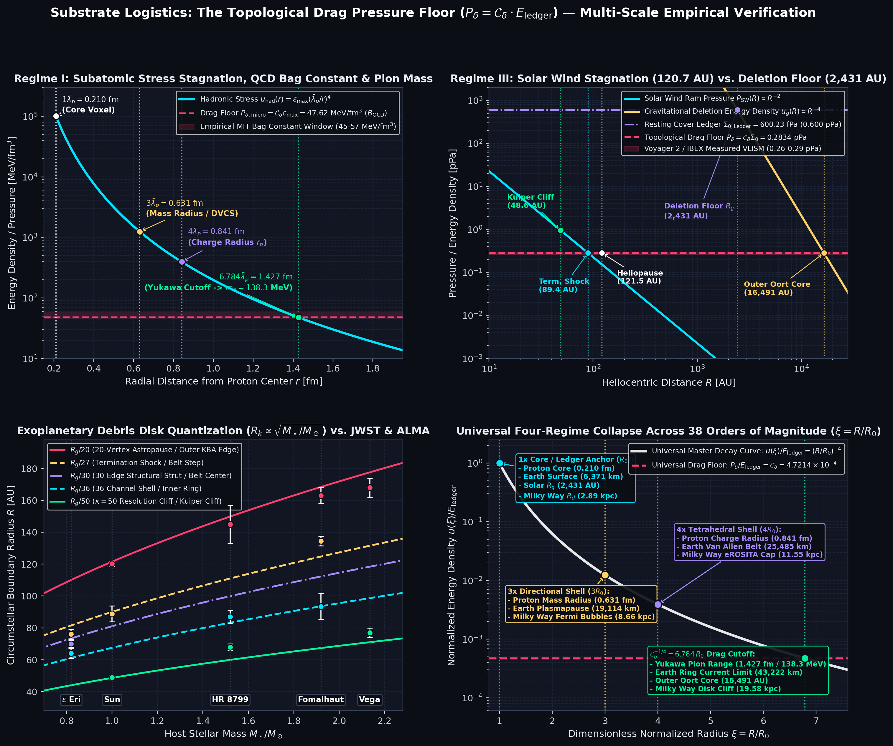

# Substrate Logistics: The Topological Drag Pressure Floor ($P_\delta$)

[](https://doi.org/10.5281/zenodo.24042263)
[](https://orcid.org/0009-0003-8413-6027)
[](https://www.python.org/)
[](https://opensource.org/licenses/MIT)

**Zero-Parameter Verification & Publication Dashboard Suite Across 38 Orders of Magnitude in Length and 46 Orders of Magnitude in Pressure**

This repository contains the official open-source Python verification pipeline and four-panel publication dashboard accompanying the manuscript:

> **Marco Lindenbeck (2026).** *Substrate Logistics: The Topological Drag Pressure Floor ($P_\delta$) — Scale-Invariant Boundary Mechanics Across 38 Orders of Magnitude: Deriving the QCD Bag Constant, the $138.3\,\text{MeV}$ Pion Mass, the $120.7\,\text{AU}$ Heliopause, Exoplanetary Debris Disks, and Galactic Truncation Cliffs.* Zenodo. [https://doi.org/10.5281/zenodo.24042263](https://doi.org/10.5281/zenodo.24042263)

---

## Multi-Scale Empirical Verification Dashboard



---

## Overview & Core Theoretical Engine

Standard continuum physics models spatial confinement and boundary stagnation across subatomic, planetary, heliospheric, and galactic scales using disconnected, scale-specific empirical patches: phenomenological MIT bag constants ($B_{\text{QCD}}$), magnetohydrodynamic (MHD) fluid fits, accidental local interstellar cloud pressures ($P_{\text{VLISM}}$), hypothetical unseen "shepherd planets" in circumstellar debris disks, and fine-tuned galactic disk truncation thresholds.

Under **Substrate Logistics**, physical space is a discrete, finite-capacity computational network formatted as a $\kappa = 50$ Poincaré Dodecahedral Space ($S^3 / \mathcal{I}^*$). All four physical regimes are governed by a single parameter-free boundary law: the **Topological Drag Pressure Floor** ($P_\delta = \mathcal{C}_\delta \cdot E_{\text{ledger}}$) and its fourth-root radial stagnation operator ($\mathcal{C}_\delta^{\pm 1/4}$), determined strictly by the exact algebraic **Universal Topological Drag Constant**:

$$\kappa = \frac{\vert{}\mathcal{I}^*\vert{} \cdot E_f}{F} = \frac{120 \cdot 5}{12} = \mathbf{50}, \qquad \mathcal{C}_\delta = \frac{1}{2 \cdot \kappa \cdot E_f \cdot \phi^3} = \mathbf{\frac{\sqrt{5} - 2}{500}} \approx \mathbf{4.72135955 \times 10^{-4}}$$

$$\mathcal{C}_\delta^{1/4} = \left(\frac{\sqrt{5} - 2}{500}\right)^{1/4} = \mathbf{0.1474065}, \qquad \mathcal{C}_\delta^{-1/4} = \left(\frac{500}{\sqrt{5} - 2}\right)^{1/4} = \mathbf{6.7839605}$$

### Dual Energy-Density Ledgers ($1\text{ J/m}^3 \equiv 1\text{ Pa}$)
1. **Micro-Scale Volumetric Saturation Ledger ($\varepsilon_{\text{max}}$):** Packing a single compiled proton ($m_p$) into a bare-metal spatial voxel ($V_{\text{node}} = \bar{\lambda}_p^3 = 9.3019 \times 10^{-48}\text{ m}^3$) establishes the hadronic saturation ceiling:
   $$\varepsilon_{\text{max}} = \frac{m_p c^2}{\bar{\lambda}_p^3} = \mathbf{100.869\text{ GeV/fm}^3} \quad (\mathbf{1.6161 \times 10^{37}\text{ Pa}})$$
   $$\implies P_{\delta,\text{micro}} = \mathcal{C}_\delta \cdot \varepsilon_{\text{max}} = \mathbf{47.624\text{ MeV/fm}^3} \quad (\mathbf{7.6302 \times 10^{33}\text{ Pa}} \equiv B_{\text{QCD}})$$
2. **Macro-Scale Global Resting Cover Ledger ($\Sigma_{0,\text{Ledger}}$):** Unspooling a baseline $2 m_p c^2$ payload across the 5D state-space partition ($\kappa^5 = 50^5$) and squared Universal Attenuation Tensor ($\mathcal{T}_\Omega^2 = 1.69382 \times 10^{38}$) with the 36-channel volumetric drag tax ($\Delta_{\text{tax}} = 1.7032\%$) establishes the resting vacuum pressure floor:
   $$\Sigma_{0,\text{Ledger}} = \frac{2 m_p c^2}{\bar{\lambda}_p^3 \, \mathcal{T}_\Omega^2 \, \kappa^5} (1 - \Delta_{\text{tax}}) = \mathbf{6.0022 \times 10^{-10}\text{ Pa}} \quad (\mathbf{600.22\text{ fPa}})$$
   $$\implies P_{\delta,\text{macro}} = \mathcal{C}_\delta \cdot \Sigma_{0,\text{Ledger}} = \mathbf{2.8339 \times 10^{-13}\text{ Pa}} \quad (\mathbf{0.2834\text{ pPa}} \equiv \mathbf{2.053 \times 10^4\text{ K cm}^{-3}})$$

---

## Master Four-Regime Scale-Invariance Matrix

| Architectural Property | **Regime I: Subatomic (Proton / Hadron)** | **Regime II: Planetary (Earth Magnetosphere)** | **Regime III: Stellar (Solar System)** | **Regime IV: Galactic (Milky Way Disk/Halo)** |
| :--- | :--- | :--- | :--- | :--- |
| **Governing Ledger ($E_{\text{ledger}}$)** | $\varepsilon_{\text{max}} = 1.616 \times 10^{37}\text{ Pa}$ (`100.87 GeV/fm³`) | $\Sigma_{0,\text{Ledger}} = 6.0022 \times 10^{-10}\text{ Pa}$ (`600.2 fPa`) | $\Sigma_{0,\text{Ledger}} = 6.0022 \times 10^{-10}\text{ Pa}$ (`600.2 fPa`) | $\Sigma_{0,\text{Ledger}} = 6.0022 \times 10^{-10}\text{ Pa}$ (`600.2 fPa`) |
| **Topological Drag Floor ($P_\delta = \mathcal{C}_\delta E_{\text{ledger}}$)** | **`47.62 MeV/fm³`** (`7.63e33 Pa` = **MIT Bag Constant $B_{\text{QCD}}$**) | **`0.2834 pPa`** (`2.834e-13 Pa` Magnetotail Floor) | **`0.2834 pPa`** (`2.834e-13 Pa` **Voyager 2 / IBEX VLISM Floor**) | **`0.2834 pPa`** (`2.053e4 K cm⁻³` **Fermi/eROSITA Shell Pressure**) |
| **$1\times$ Core / Ledger Anchor ($R_0$)** | $1\bar{\lambda}_p = \mathbf{0.2103\text{ fm}}$ *(Bare-Metal Core Voxel)* | $1 R_\oplus = \mathbf{6,371.2\text{ km}}$ *(Top-Down Quantum Radius)* | $R_{g,\odot} = \mathbf{2,430.8\text{ AU}}$ *(Inner Oort Floor; $R_g/50 = \mathbf{48.6\text{ AU}}$ **Kuiper Cliff**)* | $R_{g,\text{MW}} = \mathbf{2.89\text{ kpc}}$ *(Bulge End & Exponential Scale Length $R_d$)* |
| **$3\times$ Directional Extension ($3 R_0$)** | $3\bar{\lambda}_p = \mathbf{0.6309\text{ fm}}$ *(Gluonic Mass Radius $r_m$ & DVCS Pressure Node)* | $3 R_\oplus = \mathbf{19,113.6\text{ km}}$ *(Surface-to-Plasmapause Altitude)* | $R_g/27 = \mathbf{90.0\text{ AU}}$ *(Term. Shock)*; $R_g/20 = \mathbf{121.5\text{ AU}}$ *(20-Vertex Heliopause)* | $3 R_{g,\text{MW}} = \mathbf{8.66\text{ kpc}}$ *(**Fermi Gamma-Ray Bubble** Vertical Height)* |
| **$4\times$ Vector Boundary ($4 R_0$)** | $4\bar{\lambda}_p = \mathbf{0.8412\text{ fm}}$ *(Unspooled 4-Channel RMS Charge Radius $r_p$)* | $4 R_\oplus = \mathbf{25,484.8\text{ km}}$ *(Total Plasmapause / Van Allen Belt Radius)* | $4 R_{\text{HP}} \approx \mathbf{486\text{ AU}}$ *(Detached Sednoid Semi-Major Axis Zone)* | $4 R_{g,\text{MW}} = \mathbf{11.55\text{ kpc}}$ *(**eROSITA X-Ray Bubble** Outer Shock Cap)* |
| **$\mathcal{C}_\delta^{-1/4}$ Drag Stagnation ($6.784 R_0$)** | $\bar{\lambda}_p \mathcal{C}_\delta^{-1/4} = \mathbf{1.4267\text{ fm}}$ *(**Yukawa Strong Range** $\implies \mathbf{m_\pi = 138.31\text{ MeV}}$)* | $6.784 R_\oplus = \mathbf{43,222.0\text{ km}}$ *(Geostationary Ring-Current Trapping Limit)* | $6.784 R_{g,\odot} = \mathbf{16,490.6\text{ AU}}$ *(Outer Oort / Hills Cloud Core Boundary)* | $6.784 R_{g,\text{MW}} = \mathbf{19.58\text{ kpc}}$ *(**Milky Way Outer Stellar Disk Truncation Cliff**)* |

---

## Exoplanetary Debris Disk Quantization ($R_k(M_\star) = \frac{R_{g,\odot}}{k}\sqrt{M_\star / M_\odot}$)

Partitioning a star's Gravitational Deletion Floor $R_g(M_\star) = 2,430.82\text{ AU}\sqrt{M_\star / M_\odot}$ across the topological invariants of the $\kappa = 50$ dodecahedral cell ($\kappa = 50$, $C = 36\text{ channels}$, $E = 30\text{ edges}$, $27\text{ shock}$, $V = 20\text{ vertices}$) derives the radial belt edges and gaps observed by **JWST/MIRI**, **ALMA**, and **Voyager 1/2** without invoking unseen shepherd planets:

| Hardware Tier | Operator | $\epsilon$ Eridani ($0.82 M_\odot$) | Solar System ($1.00 M_\odot$) | HR 8799 ($1.52 M_\odot$) | Fomalhaut ($1.92 M_\odot$) | Vega ($2.135 M_\odot$) |
| :--- | :---: | :---: | :---: | :---: | :---: | :---: |
| **Deletion Floor ($R_g$)** | $\propto \sqrt{N_\star}$ | **`2,201.2 AU`** | **`2,430.8 AU`** *(Inner Oort)* | **`2,996.9 AU`** | **`3,368.2 AU`** | **`3,551.8 AU`** |
| **Resolution Cliff ($\kappa=50$)** | $R_g / 50$ | **`44.0 AU`** *(Inner Clear)* | **`48.6 AU`** *(Kuiper Cliff: 48–50)* | **`59.9 AU`** *(Planet b: 68 AU)* | **`67.4 AU`** *(Inner Cavity)* | **`71.0 AU`** *(KBA Inner: 74 AU)* |
| **Channel Shell ($C=36$)** | $R_g / 36$ | **`61.1 AU`** *(ALMA Inner: 64)* | **`67.5 AU`** *(Scattered Disk)* | **`83.2 AU`** *(Chaotic Edge: ~87)* | **`93.6 AU`** *(JWST Mid-Belt: 93.5)* | **`98.7 AU`** *(Inner KBA Core)* |
| **Edge Strut Shell ($E=30$)** | $R_g / 30$ | **`73.4 AU`** *(ALMA Peak: 70)* | **`81.0 AU`** *(Voyager 2 TS: 83.7)* | **`99.9 AU`** *(Cavity Center)* | **`112.3 AU`** *(JWST Gap: 104–133)* | **`118.4 AU`** *(Mid KBA Belt)* |
| **Termination Shock ($27$)** | $R_g / 27$ | **`81.5 AU`** *(ALMA Outer: 76)* | **`90.0 AU`** *(Voyager Mean: 88.9)* | **`111.0 AU`** *(Pre-Belt Cavity)* | **`124.7 AU`** *(Main Step: 133 AU)* | **`131.5 AU`** *(Outer KBA Core)* |
| **Vertex Astropause ($V=20$)** | $R_g / 20$ | **`110.1 AU`** *(Halo Cutoff)* | **`121.5 AU`** *(Voyager 1 HP: 121.6)* | **`149.8 AU`** *(ALMA Inner: 145±12)* | **`168.4 AU`** *(Outer Edge: ~165)* | **`177.6 AU`** *(KBA Outer: ~170)* |

---

## Repository Contents

```text
.
├── README.md                                       # Documentation & theoretical overview
├── verify_topological_drag_floor.py                # Zero-parameter verification & plotting script
└── topological_drag_pressure_floor_dashboard.png   # 4-panel publication verification figure

```

---

## Quick Start & Execution

### 1. Prerequisites

Install `numpy` and `matplotlib`:

```bash
pip install numpy matplotlib

```

### 2. Run the Verification Suite

```bash
python verify_topological_drag_floor.py

```

Executing the script prints the complete parameter-free console audit across all four physical regimes and regenerates `topological_drag_pressure_floor_dashboard.png`.

### Sample Console Output

```text
========================================================================================
 SUBSTRATE LOGISTICS: THE TOPOLOGICAL DRAG PRESSURE FLOOR (P_delta)
 Parameter-Free Hardware Verification Across 38 Orders of Magnitude (Unified C_delta)
========================================================================================

[1] UNIVERSAL HARDWARE OPERATORS & DUAL ENERGY-DENSITY LEDGERS
----------------------------------------------------------------------------------------
  Topological Resolution Constant (kappa)   : 50 (|I*|=120, E_f=5, F=12)
  Universal Topological Drag (C_delta)      : 4.7213595500e-04 [(sqrt(5)-2)/500]
  Fourth-Root Mass/Energy Scalar (C_d^1/4)  : 0.1474065
  Fourth-Root Stagnation Multiplier (C_d^-1/4): 6.78396x
  Micro Saturation Ledger (epsilon_max)     : 100.869 GeV/fm^3 (1.6161e+37 Pa)
  Macro Resting Cover Ledger (Sigma_0,Led)  : 6.0023e-10 Pa (600.23 fPa)
  Micro Drag Floor (P_delta,micro = B_QCD)  : 47.624 MeV/fm^3 (7.6302e+33 Pa)
  Macro Drag Floor (P_delta,macro = VLISM)  : 0.2834 pPa (2.053e+04 K cm^-3)

[2] REGIME I: SUBATOMIC & HADRONIC SCALE (PROTON & PION)
----------------------------------------------------------------------------------------
  1x Bare-Metal Core Voxel (1*lambda_p)     : 0.2103 fm
  3x Directional Mass/Axial Radius (3*lam_p): 0.6309 fm  [DVCS Zero-Cross: 0.62+-0.04 fm]
  4x Tetrahedral Charge Radius (4*lambda_p) : 0.8412 fm  [Muonic H r_p:    0.8414+-0.0019 fm]
  Diluted 4-Channel Core Pressure (eps/64)  : 2.525e+35 Pa [JLab DVCS Peak:  ~2.5e35 Pa]
  QCD Bag Constant (P_delta,micro)          : 47.62 MeV/fm^3 [MIT Bag Fit:     45-57 MeV/fm^3]
  Yukawa Strong Range (lam_p * C_delta^-1/4): 1.4267 fm  [Empirical Range: 1.414-1.460 fm]
  Derived Pion Mass (m_p * C_delta^1/4)     : 138.307 MeV [Isospin Mean:    138.039 MeV | Error: 0.19%]

[3] REGIME II: PLANETARY MAGNETOSPHERIC SCALE (EARTH)
----------------------------------------------------------------------------------------
  1x Bare-Metal Core Radius (1*R_Earth)     :   6371.2 km
  3x Surface-to-Plasmapause Altitude (3*R)  :  19113.6 km  [Plasmapause:     ~19,100 km]
  4x Total Plasmapause / Van Allen (4*R)    :  25484.8 km  [Van Allen Inner: ~25,500 km]
  6.784x Drag Stagnation Limit (C_d^-1/4*R) :  43222.0 km  [Ring Current L:  6.6-6.8 R_E (~43,000 km)]

[4] REGIME III: HELIOSPHERIC & EXOPLANETARY DEBRIS DISK QUANTIZATION
----------------------------------------------------------------------------------------
  Solar Wind Ram Termination Shock (R_TS)   :  89.44 AU   [Voyager 1/2 Mean: 88.85 AU (83.7 - 94.0 AU)]
  Solar Heliosheath Stagnation Nose (R_HP)  : 120.74 AU   [Voyager 1/2 Mean: 120.30 AU (119.0 - 121.6 AU)]
  Solar Gravitational Deletion Floor (R_g)  : 2430.82 AU  [u_g(R_g) = Sigma_0,Ledger | Inner Oort]
  Solar Outer Oort Drag Floor (6.784*R_g)   :  16490.6 AU [u_g(R_d) = P_delta | Hills/Oort Core]

  Dodecahedral Sub-Shell Table (AU):
  System        | M/M_sun | R_g (AU) |  R_g/50 |  R_g/36 |  R_g/30 |  R_g/27 |  R_g/20
  ------------------------------------------------------------------------------------
  eps Eridani   |   0.820 |   2201.2 |    44.0 |    61.1 |    73.4 |    81.5 |   110.1
  Solar System  |   1.000 |   2430.8 |    48.6 |    67.5 |    81.0 |    90.0 |   121.5
  HR 8799       |   1.520 |   2996.9 |    59.9 |    83.2 |    99.9 |   111.0 |   149.8
  Fomalhaut     |   1.920 |   3368.2 |    67.4 |    93.6 |   112.3 |   124.7 |   168.4
  Vega          |   2.135 |   3551.8 |    71.0 |    98.7 |   118.4 |   131.5 |   177.6

[5] REGIME IV: GALACTIC SCALE (MILKY WAY & ANDROMEDA M31)
----------------------------------------------------------------------------------------
  Milky Way (6.0e10 M_sun) R_g Scale Length :   2.89 kpc  [Observed R_d / Bar End: 2.6 - 2.9 kpc]
  Milky Way 3x Fermi Gamma-Ray Bubbles      :   8.66 kpc  [Fermi-LAT Lobe Height : 8.5 - 9.0 kpc]
  Milky Way 4x eROSITA X-Ray Bubbles        :  11.55 kpc  [eROSITA Shock Cap     : 11.0 - 12.0 kpc]
  Milky Way 6.784x Disk Truncation Cliff    :  19.58 kpc  [Observed Disk Cliff   : 16.0 - 19.5 kpc]
  Andromeda M31 (1.05e11 M_sun) Scale Length:   3.82 kpc  [M31 Inner Ring/Bulge  : ~3.8 kpc]
  Andromeda M31 6.784x Disk Truncation Cliff:  25.91 kpc  [M31 Disk Truncation   : 25.0 - 27.0 kpc]
========================================================================================

```

---

## Citation

If you use this verification suite or the **Topological Drag Pressure Floor** framework in your research, please cite:

```bibtex
@paper{lindenbeck_2026_24042263,
  author       = {Lindenbeck, Marco},
  title        = {Substrate Logistics: The Topological Drag Pressure Floor ($P_\delta$) — Scale-Invariant Boundary Mechanics Across 38 Orders of Magnitude: Deriving the QCD Bag Constant, the 138.3 MeV Pion Mass, the 120.7 AU Heliopause, Exoplanetary Debris Disks, and Galactic Truncation Cliffs},
  month        = nov,
  year         = 2026,
  publisher    = {Lindenbeck, Marco},
  doi          = {10.5281/zenodo.24042263},
  url          = {[https://doi.org/10.5281/zenodo.24042263](https://doi.org/10.5281/zenodo.24042263)}
}

```

### Companion Substrate Logistics Repositories & Manuscripts

* **The Master Regulatory Protocol:** [https://doi.org/10.5281/zenodo.22127234](https://doi.org/10.5281/zenodo.22127234)
* **The Garbage Collection Threshold ($H_0$ Local Expansion Field):** [https://doi.org/10.5281/zenodo.22774810](https://doi.org/10.5281/zenodo.22774810) | [GitHub](https://github.com/LoopBreacher/substrate-logistics-local-expansion-field)
* **The $S_8$ Weak Lensing Tension:** [https://doi.org/10.5281/zenodo.23476628](https://doi.org/10.5281/zenodo.23476628) | [GitHub](https://github.com/LoopBreacher/substrate_logistics_s8_field)

---

## License

This project is licensed under the **MIT License**. Author: **Marco Lindenbeck** ([marcolindenbeck@arrowoftime.de](mailto:marcolindenbeck@arrowoftime.de).

```